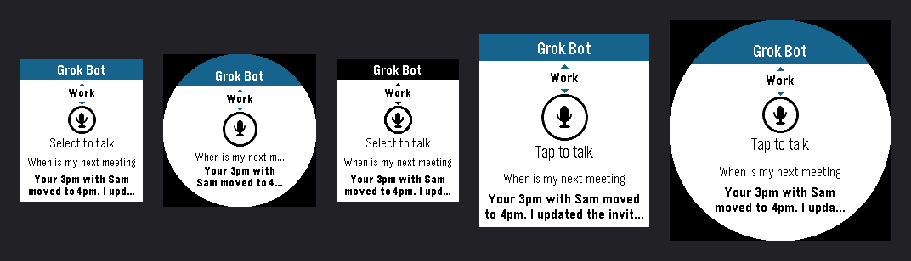
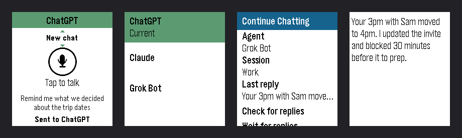

# Agent Chat

Talk to your AI agents from your Pebble. Press a button, speak, and your words go to Claude, ChatGPT, Grok Bot, Muse, or any other agent plugin installed in the Pebble app. When the agent can answer back, the reply shows up on your wrist.



Agent Chat is a watchapp built on the [Pebble plugins](https://developer.repebble.com/guides/plugins/) agent contract (`send_to_agent`, `agent/chats`, `agent/configured`). It finds every agent plugin you have installed. Switching between them, and between their recent chats, works the same for all of them, and each plugin only gets the features it supports.

## Features

- **Listens on launch.** Open it from quick launch and start talking. Dictation starts right away.
- **Any agent plugin.** Every installed plugin that offers `send_to_agent` shows up. Switch agents from settings, or by holding Select.
- **Recent sessions.** Up and Down walk through the agent's recent chats (from `agent/chats`), plus a **New chat** entry where the agent supports one. After you send to a new chat, Agent Chat switches to that conversation so you can keep talking in it.
- **Replies on the watch** for agents that return them:
  - Grok Bot: Agent Chat polls its read action until the bot answers.
  - Universal AI: the answer comes straight back from the send.
- **Buttons and touch.** Every control has a touchscreen equivalent on Pebble Time 2 and Round 2. Touch can be turned off in settings.
- **Never sends twice.** A send that may or may not have arrived is reported as such and never retried automatically.
- **Runs on every Pebble with a microphone**, color or black-and-white, rectangular or round.



## Supported agents

Any plugin that implements the agent contract works. These were checked against their published source:

| Plugin | Sessions | Replies on the watch | Notes |
|---|---|---|---|
| **Claude** (Core Devices) | Chats and Claude Code sessions, New chat | No, send-only | Code sessions must be reachable from claude.ai (see [Troubleshooting](#troubleshooting)) |
| **ChatGPT** (Core Devices) | Dot, chats, Codex sessions and tasks, New chat | No, send-only | |
| **Grok Bot** (Core Devices) | Bots and groups | Yes, polled with `read_grok_bot` | Turn **Wait for replies** off to skip polling |
| **Muse** (Core Devices) | Main chat and side chats | No, send-only | |
| **[Universal AI](https://github.com/ericlmccormick/Pebble-Universal-AI)** (Eric McCormick) | Conversations, New chat | Yes, returned by the send | Uses your own API keys for Gemini, OpenAI, Anthropic, xAI, OpenRouter, DeepSeek or Meta |

Send-only agents still get your message. You read the answer in that agent's own app.

## Controls

| Action | Button | Touch (Time 2, Round 2) |
|---|---|---|
| Start or stop listening | Select | Tap |
| Previous / next session | Up / Down | Swipe down / up |
| Switch agent | Hold Select | Press and hold |
| Settings | Back | Back swipe (left to right) |

In settings, **Continue Chatting** (or the select swipe, right to left) returns to the chat. **Back** (or the back swipe) closes the app.

When a reply arrives, the watch buzzes and opens it. Up and Down scroll, Select answers it (starts listening), and Back closes it.

### Settings

Rows appear only when the active agent supports them.

| Setting | What it does |
|---|---|
| Continue Chatting | Back to the chat screen |
| Agent | Pick the active agent plugin |
| Session | Pick a chat (agents with `agent/chats`) |
| Last reply | Re-read the last reply |
| Check for replies | Fetch the latest reply now (agents with a read action) |
| Wait for replies | Poll for a reply after sending (agents with a read action) |
| Review before send | See and confirm the transcription before it is sent |
| Listen on launch | Start dictation as soon as the app opens |
| Touch controls | Turn touch gestures on or off (touchscreen watches) |
| Exit | Close the app |

## Requirements

- **A Pebble with a microphone:** Pebble Time, Time Round, Pebble 2, Pebble 2 Duo, Pebble Time 2 or Pebble Round 2. The original Pebble has no microphone and isn't supported.
- **The Pebble mobile app with plugins.** Plugins arrived in app 1.16, where they're under Settings → Plugins; they're on for everyone from 2.0.0.
- **At least one agent plugin,** installed from the Pebble appstore and signed in (or, for Universal AI, given an API key) in its settings.

## Building

You need **Pebble SDK 4.44 or later and pebble-tool 5.1.0 or later.** Older toolchains produce a "legacy" app (`manifestVersion` 1), and the phone hides all plugins from legacy apps.

```sh
git clone https://github.com/clbwhazzup/agent_chat.git
cd agent_chat

uv tool install pebble-tool        # or: uv tool upgrade pebble-tool
pebble sdk install latest

pebble build
pebble install --phone <phone-ip>  # or --cloudpebble, or --emulator emery
```

### Tests

The phone-side logic has a Node test suite (Node 18 or later, no dependencies):

```sh
npm test
```

`test/flow.test.js` runs `src/pkjs/index.js` against a fake Pebble app and fake plugins, modelled on the real Claude, Grok Bot, Muse and Universal AI manifests. It covers:
- agent discovery and capabilities
- session lists
- sends and failures
- polling for Grok Bot replies
- Universal AI's inline answers
- following a newly created chat

The Pebble emulator has no plugin host, so on an emulator the app shows "Agent plugins need the latest Pebble app". The screenshots were taken on the emulators with fake plugins standing in.

### Appstore assets

- `screenshots/`: five screenshots per platform at each watch's exact screen size, named `<platform>_<n>_<name>.png` as `pebble publish` expects. Pebble 2 (diorite) reuses the Pebble 2 Duo (flint) images, since both have the same black-and-white screen.
- `store/banner.png`: the 720×320 listing banner.
- `docs/`: composite images used by this README.

## How it works

```
watch (C)                      phone (PebbleKit JS)                agent plugin
───────────                    ────────────────────                ────────────
dictation ──── TEXT ─────────▶ Pebble.invokeAction ──────────────▶ send_to_agent
UI state  ◀─── AGENTS, ──────── Pebble.enumeratePlugins
               SESSIONS, ◀───── Pebble.subscribeToSource ◀───────── agent/chats
               STATUS           (agent/chats, agent/configured)     agent/configured
reply view ◀── REPLY ─────────── read action / inline answer ◀───── read_* / send result
```

- **The watch** dictates, draws the UI and stores preferences. It also caches the last agent and session, so the first frame after launch is already right.
- **The phone** is the source of truth for which agent and session are active. It finds agents by the `send_to_agent` action and works out what each one can do from its manifest:
  - `agent/chats` → sessions
  - a `read_*` action → polled replies
  - an inline answer → immediate replies

Project layout:

```
src/c/main.c            entry point, AppMessage, dictation, touch routing
src/c/main_window.c     chat screen, buttons and touch gestures
src/c/settings_menu.c   settings menu, agent and session pickers
src/c/reply_window.c    scrolling reply view
src/c/prefs.c           preferences and launch cache
src/pkjs/index.js       plugin discovery, subscriptions, sending, reply polling
src/pkjs/agents.js      pure helpers (agent detection, sessions, error text)
test/                   Node test suite
```

### Permissions

The app declares `InvokeAction` for each agent plugin it knows about (Claude, ChatGPT, Grok Bot, Muse, Universal AI), so you can approve each one when you install it. All of them are optional. Other agent plugins still work: the Pebble app asks for permission the first time one is used.

## Troubleshooting

- **"No agent plugins" / no agents found.**
  - Turn on plugins in the Pebble app and install an agent plugin.
  - If you built the app yourself, check you used SDK 4.44+ and pebble-tool 5.1+. In `pebble logs`, a legacy build shows `0 plugin(s) enumerated`.
- **A Claude Code session isn't listed.** Local Claude Code sessions are only reachable once Remote Control is on: run `/remote-control` in the session, or turn on *Enable Remote Control for all sessions*. Claude Code must stay running on your computer.
- **"Claude reported a session conflict (HTTP 409)".** Claude was busy with that chat, usually still replying. Check the chat before sending again.
- **"Set up <agent>: open its settings in the Pebble app".** The plugin isn't signed in, or has no API key. Open its settings in the Pebble app.
- **Dictation mishears you.** Turn on **Review before send** to check the text, or redo it, before it goes out.
- **Long Universal AI answers fail with "No receipt…".** The Pebble app stops a plugin action after about 20 seconds. Slow models or very long answers can hit that limit, and the question may still have reached the provider.

Something else? [Open an issue](https://github.com/clbwhazzup/agent_chat/issues) and include the output of `pebble logs` if you can.

## Limitations

- The Claude, ChatGPT and Muse plugins don't return answers, so their replies stay in those apps.
- Replies are shortened to about 1,000 characters on the watch.
- At most 8 agents and 24 sessions per agent are listed.
- Dictation is Pebble's system speech recognition. The app can't change how well it recognizes speech.

## Acknowledgements

- Core Devices for Pebble, the plugin platform, and the [Claude, ChatGPT, Grok Bot and Muse plugins](https://github.com/coredevices/pebble-plugins).
- Eric McCormick for [Universal AI](https://github.com/ericlmccormick/Pebble-Universal-AI).
